  

  
  
  
  
  
  
  
  

---

# 🚀 Awesome Frontend Frameworks

> A definitive, SEO-optimized, community-curated directory of **modern frontend frameworks**, **UI component architectures**, **reactivity models**, and **frontend cloud hosting platforms** for 2026.

Whether you are architecting a high-scale enterprise single-page application (SPA), building content-driven static websites with islands architecture, or optimizing server-rendered HTML with minimal JavaScript, this guide provides performance benchmarks, architectural comparisons, and hosting platform economics to help you choose the right web development stack.

---

## 📑 Table of Contents

- [🌐 Sector Overview & Market Dynamics](#-sector-overview--market-dynamics)
- [☁️ SaaS & Hosted Frontend Cloud Platforms](#️-saas--hosted-frontend-cloud-platforms)
- [📦 Top Open-Source Frontend Frameworks (Ranked by Stars)](#-top-open-source-frontend-frameworks-ranked-by-stars)
- [🧭 Architecture & Selection Matrix](#-architecture--selection-matrix)
- [🤝 How to Contribute](#-how-to-contribute)
- [💖 Support](#-support)
- [📈 Star History](#--star-history)
- [⚖️ Disclaimer & License](#️-disclaimer--license)

---

## 🌐 Sector Overview & Market Dynamics

The global frontend cloud and Jamstack hosting market is estimated at **$4.8 billion in 2024**, projected to surpass **$12.3 billion by 2030** (~17.2% CAGR) driven by enterprise adoption of decoupled headless frontends, edge rendering, and full-stack meta-frameworks.

The sector is **moderately fragmented**: hyperscalers (AWS, Cloudflare) dominate global CDN backbone and multi-region compute infrastructure, while developer-first platforms (Vercel, Netlify) capture high developer mindshare and workflow productivity via deep framework integrations. Rather than a winner-take-all monopoly, the market sustains healthy multi-tiered competition between commodity cloud compute providers and premium developer experience (DX) layers.

---

## ☁️ SaaS & Hosted Frontend Cloud Platforms

Below is an overview of major SaaS frontend cloud platforms and managed deployment infrastructures, **sorted in descending order by company valuation / market capitalization**.

| Platform | Company Valuation / Market Cap | Starting Pricing | Free Tier Limits | Key Highlights & Architecture |
| :--- | :--- | :--- | :--- | :--- |
| **[AWS Amplify](https://aws.amazon.com/amplify/)** ☁️ | **~$2.1 Trillion** *(NASDAQ: AMZN, AWS ~$105B ARR)* | **$0.01 / build minute** + **$0.15 / GB served** *(Pay-as-you-go above free tier)* | **12-Month Free Tier:** 1,000 build minutes/month, 15 GB bandwidth served/month, 5 GB storage; beyond 12 months, pay-as-you-go rates apply | Global AWS edge infrastructure; full-stack CI/CD with Git integration, native SSR hosting for Next.js, and automated backend provisioning via AWS CDK/CloudFormation. |
| **[Cloudflare Pages](https://pages.cloudflare.com/)** ⚡ | **~$35 Billion** *(NYSE: NET, ~$1.7B ARR)* | **$20 / month** *(Pro Plan)* or **$5 / month** *(Workers Paid)* | **Free Forever:** 500 builds/month, 1 concurrent build, unlimited requests, **unmetered static bandwidth**, 100 custom domains per project, 20,000 files/site, 100,000 Pages Functions (Workers Free) req/day | Zero-cold-start edge compute deployed across 330+ cities worldwide; direct Git integrations, preview URLs, and full interoperability with Cloudflare KV, D1 SQL, and R2 object storage. |
| **[Vercel](https://vercel.com/)** ▲ | **$3.25 Billion** *(Valuation Series E, ~$100M+ ARR)* | **$20 / deploying seat / month** *(Pro Plan; includes $20/mo pooled infrastructure credit)* | **Free Forever (Hobby):** 100 GB Fast Data Transfer/month, 100 deployments/day, 45-minute build timeout, 1 concurrent build, non-commercial personal use only *(hard cap: pauses project if exceeded)* | First-party platform built by the creators of Next.js; automated preview deployments, edge middleware, Serverless Functions, incremental static regeneration (ISR), and integrated web analytics. |
| **[Netlify](https://www.netlify.com/)** 🌐 | **$2.0 Billion** *(Valuation Series D, ~$60M+ ARR)* | **$20 / month** *(Pro Plan with 3,000 credits/month & unlimited team seats)* | **Free Forever (Starter):** 300 credits/month *(~15 GB bandwidth or 20 production deploys)*, 1 concurrent build, 1-day log retention, unlimited deploy previews *(hard cap: pauses site upon limit exhaustion)* | Pioneer of the Jamstack architecture; framework-agnostic build pipeline, edge functions, serverless blob storage, automated form handling, branch deploy previews, and identity management. |
| **[Render](https://render.com/)** 🚀 | **~$300 Million** *(Valuation Series B, ~$15M+ ARR)* | **$19 / user / month** *(Team Workspace)* or **$7 / service / month** *(Starter compute)* | **Free Forever (Hobby):** 100 GB static site bandwidth/month, 500 build minutes/month, 512 MB shared RAM web service *(automatically spins down/sleeps after 15 minutes of inactivity)* | Unified modern cloud alternative to traditional PaaS; hosts static sites, Docker containers, Node/Python/Go web services, cron workers, and managed PostgreSQL databases under a single dashboard. |

---

## 📦 Top Open-Source Frontend Frameworks (Ranked by Stars)

The following open-source frameworks and meta-frameworks are **sorted in descending order by GitHub star count**. Each entry includes live GitHub star count badges linking directly to their official stargazers community.

---

### 1. [React](https://github.com/facebook/react) ⚛️

* **Architecture & Reactivity:** Virtual DOM with Fiber reconciler, React Hooks, Suspense for data fetching, React Server Components (RSC), and optional ahead-of-time memoizing compiler (React Compiler).
* **Market Share & Community:** Category leader with ~44.7% industry market share; massive global ecosystem of packages, state managers, and enterprise talent pool.
* **Best For:** Large-scale enterprise applications, cross-platform code sharing (React Native), and rich full-stack setups paired with meta-frameworks like Next.js or React Router.
* **License:** MIT

---

### 2. [Next.js](https://github.com/vercel/next.js) ▲

* **Architecture & Reactivity:** The flagship full-stack React meta-framework; features App Router, React Server Components (RSC), Server Actions, Turbopack Rust-based bundler, and Hybrid Rendering (SSG, SSR, ISR).
* **Market Share & Community:** The primary production standard for modern React web applications; backed by Vercel with extensive community adoption.
* **Best For:** Production-ready full-stack React web apps, e-commerce storefronts, high-traffic media sites, and SEO-critical web portals.
* **License:** MIT

---

### 3. [Angular](https://github.com/angular/angular) 🅰️

* **Architecture & Reactivity:** Full-featured enterprise platform; features TypeScript-first architecture, dependency injection, reactive Signals for zoneless change detection, deferrable views (`@defer`), and hydration-friendly SSR.
* **Market Share & Community:** ~18.2% market share; deeply entrenched in enterprise IT, banking, healthcare, and mission-critical enterprise dashboards.
* **Best For:** Large corporate teams demanding an opinionated, batteries-included structure, strict typing, and guaranteed long-term stability.
* **License:** MIT

---

### 4. [Svelte / SvelteKit](https://github.com/sveltejs/svelte) 🧡

* **Architecture & Reactivity:** Zero-virtual-DOM compiled framework; transforms declarative component markup into ultra-efficient surgical DOM mutations at build time. Svelte 5 introduces universal Runes (`$state`, `$derived`, `$effect`) for fine-grained reactivity.
* **Market Share & Community:** Exceptional developer satisfaction scores; benchmark-topping runtime performance and minimal client bundle overhead.
* **Best For:** High-performance web apps, resource-constrained mobile web, interactive data visualizations, and applications where fast initial page loads matter.
* **License:** MIT

---

### 5. [Astro](https://github.com/withastro/astro) 🚀

* **Architecture & Reactivity:** Content-first web framework pioneering Component Island architecture; delivers zero JavaScript to the browser by default and selectively hydrates interactive components (React, Vue, Svelte, Preact, Solid) only when needed.
* **Market Share & Community:** Rapidly adopted as the leading modern static site generator (SSG) and content management framework.
* **Best For:** Content-driven websites, developer documentation, blogs, marketing landing pages, and portfolio sites needing perfect Core Web Vitals.
* **License:** MIT

---

### 6. [Nuxt](https://github.com/nuxt/nuxt) ⛰️

* **Architecture & Reactivity:** Intuitive full-stack meta-framework for Vue 3; built on Vite and Nitro engine; features file-system routing, automatic component imports, universal rendering (SSR/SSG), and multi-engine deployment presets.
* **Market Share & Community:** The undisputed default meta-framework for Vue.js developers with an active plugin ecosystem.
* **Best For:** Full-stack Vue.js production applications, SSR web apps, multi-language websites, and rapid MVP development.
* **License:** MIT

---

### 7. [Vue.js](https://github.com/vuejs/core) 💚

* **Architecture & Reactivity:** Progressive JavaScript framework with an approachable HTML-based template syntax; features Composition API, reactive Proxies, single-file components (SFCs), and fine-grained Vapor Mode for compilation without Virtual DOM overhead.
* **Market Share & Community:** ~17.6% market share; beloved for its gentle learning curve, crystal-clear official documentation, and balanced ecosystem.
* **Best For:** Progressive enhancement of existing websites, mid-to-large single-page applications, and developer teams valuing rapid onboarding.
* **License:** MIT

---

### 8. [htmx](https://github.com/bigskysoftware/htmx) ⚡

* **Architecture & Reactivity:** High-power extensions for standard HTML; enables AJAX calls, CSS transitions, WebSockets, and Server-Sent Events (SSE) directly via HTML attributes (`hx-get`, `hx-post`, `hx-swap`, `hx-target`), bypassing heavyweight client-side JS bundles.
* **Market Share & Community:** Leading the "hypermedia-driven application" (HDA) movement; popular among Go, Python/Django, Ruby on Rails, and Elixir developers.
* **Best For:** Backend-rendered web applications desiring snappy Single-Page Application user experience without complex client build pipelines.
* **License:** Zero-Clause BSD (0BSD) / MIT

---

### 9. [Preact](https://github.com/preactjs/preact) 🪶

* **Architecture & Reactivity:** Featherweight 3 kB React alternative featuring identical modern Virtual DOM and Hooks APIs; ships `preact/compat` for drop-in interoperability with the broader npm React ecosystem.
* **Market Share & Community:** Powers high-traffic web properties (including Etsy, dev.to, and Google search widgets) requiring hyper-optimized bundle footprints.
* **Best For:** Third-party embeddable widgets, performance-sensitive mobile sites, landing pages, and micro-frontends.
* **License:** MIT

---

### 10. [Solid.js](https://github.com/solidjs/solid) 🔷

* **Architecture & Reactivity:** Truly reactive UI library compiling JSX directly into real DOM node operations without any Virtual DOM; updates fine-grained reactive primitives (Signals) independently without re-executing component functions.
* **Market Share & Community:** Consistently tops developer satisfaction indexes (90%+ retention) and independent JS performance benchmarks.
* **Best For:** High-frequency real-time updates (dashboards, crypto trading screens, online gaming interfaces, collaborative canvases).
* **License:** MIT

---

### 11. [Remix](https://github.com/remix-run/remix) 💿

* **Architecture & Reactivity:** Full-stack web framework built atop React Router and modern Web Fetch standards; emphasizes nested routing, progressive enhancement, native HTML form submissions, and robust optimistic UI updates.
* **Market Share & Community:** Maintained by the React Router core team; deeply respected for adhering to core web fundamentals.
* **Best For:** Data-intensive applications, resilient user experiences that function seamlessly over poor connections, and teams focused on Web Standards.
* **License:** MIT

---

### 12. [Alpine.js](https://github.com/alpinejs/alpine) 🏔️

* **Architecture & Reactivity:** Rugged, lightweight declarative framework (~15 kB) for orchestrating behavior directly in HTML markup using intuitive directives (`x-data`, `x-bind`, `x-on`); functions as a modern declarative jQuery replacement.
* **Market Share & Community:** The primary frontend companion for Laravel (TALL stack), Livewire, Django, and static site generators.
* **Best For:** Adding client-side interactivity (modals, dropdowns, tabs, form validations) to server-rendered web applications with zero build steps.
* **License:** MIT

---

### 13. [Ember.js](https://github.com/emberjs/ember.js) 🐹

* **Architecture & Reactivity:** Opinionated productivity framework built on the Glimmer rendering engine; features automated routing, standardized data layer (Ember Data), and long-term support (LTS) release cadence.
* **Market Share & Community:** Trusted for massive enterprise web clients (Apple Music, LinkedIn, Square) that require decade-long stability.
* **Best For:** Large engineering organizations prioritizing convention over configuration, backwards compatibility, and multi-year maintainability.
* **License:** MIT

---

### 14. [Qwik](https://github.com/QwikDev/qwik) ⚡

* **Architecture & Reactivity:** Revolutionary framework introducing **Resumability**; serializes execution state directly into server-rendered HTML, eliminating client hydration altogether and downloading JavaScript chunks strictly upon user interaction.
* **Market Share & Community:** Founded by Misko Hevery (creator of AngularJS); pioneering the next generation of instant-loading web apps.
* **Best For:** Massive e-commerce web applications, edge-rendered portals, and sites where client hydration delays directly hurt conversion rates.
* **License:** MIT

---

### 15. [Lit](https://github.com/lit/lit) 🔥

* **Architecture & Reactivity:** Ultra-fast, lightweight library (~5 kB) built on native browser **Web Components**; utilizes tagged template literals for reactive state rendering and scoped shadow DOM encapsulation without virtual DOM overhead.
* **Market Share & Community:** Google-backed standard widely used in multi-brand enterprise design systems (Adobe Spectrum, Cisco, Microsoft, Google Workspace).
* **Best For:** Universal component libraries, cross-framework design systems, and micro-frontends embeddable in any web framework.
* **License:** BSD-3-Clause

---

### 16. [Inferno](https://github.com/infernojs/inferno) 🏎️

* **Architecture & Reactivity:** Extremely fast, React-like JavaScript library designed specifically for peak rendering speeds and minimal memory consumption; provides component-level recycling and an isomorphic virtual DOM.
* **Market Share & Community:** Long-standing benchmark champion for high-throughput client rendering.
* **Best For:** High-frame-rate web applications, low-powered smart TVs/kiosks, and compute-constrained IoT displays.
* **License:** MIT

---

### 17. [Marko](https://github.com/marko-js/marko) 🎯

* **Architecture & Reactivity:** HTML-first, streaming-optimized language and framework pioneered at eBay; streams HTML chunks progressively to the client as asynchronous data resolves and hydrates only interactive tags.
* **Market Share & Community:** Powers eBay's high-traffic multi-billion dollar e-commerce storefront.
* **Best For:** Massive e-commerce applications, progressive out-of-order streaming SSR, and edge environments.
* **License:** MIT

---

### 18. [Stencil](https://github.com/ionic-team/stencil) 💎

* **Architecture & Reactivity:** Compiler that generates standards-compliant, native Web Components; features TypeScript support, virtual DOM, reactive data-binding, and automated bindings generation for React, Vue, and Angular.
* **Market Share & Community:** Created by the Ionic team; powers millions of cross-platform components worldwide.
* **Best For:** Enterprise design systems that must be authored once in TypeScript and distributed seamlessly to React, Angular, and Vue teams.
* **License:** MIT

---

## 🧭 Architecture & Selection Matrix

| Framework | Reactivity Model | Rendering Paradigm | Virtual DOM? | Typical Bundle Size | Primary Best Use Case |
| :--- | :--- | :--- | :--- | :--- | :--- |
| **React** | Component State / Hooks | Client / SSR / RSC | Yes | ~42 kB | Enterprise ecosystems, complex state, React Native |
| **Next.js** | React Server Components | Hybrid (SSR, SSG, ISR) | Yes | ~85 kB+ | Full-stack production React applications & SEO portals |
| **Angular** | Signals & Zoneless Detection | Client / SSR Hydration | No | ~60 kB+ | Enterprise IT, structured large-scale architectures |
| **Svelte 5** | Universal Runes (`$state`) | Compiled Surgical DOM | No | ~2–5 kB | High-performance apps, small devices, fast LCP |
| **Astro** | Islands Architecture | Zero-JS Default + Islands | Per-Island | ~0 kB base | Content sites, docs, blogs, multi-framework islands |
| **Nuxt** | Vue 3 Reactivity Proxies | Universal (SSR, SSG) | Yes | ~50 kB | Full-stack Vue.js applications & rapid MVPs |
| **Vue.js** | Reactive Proxies / Vapor | Progressive / SFC | Hybrid | ~16–33 kB | Fast team onboarding, progressive SPAs |
| **htmx** | Hypermedia Responses | Server-Driven HTML | No | ~14 kB | Server-rendered apps (Go/Python/Ruby/PHP) |
| **Preact** | Virtual DOM / Signals | Client / Prerender | Yes | ~3 kB | Lightweight widgets, performance landing pages |
| **Solid.js** | Fine-Grained Signals | Compiled Direct DOM | No | ~7 kB | Real-time dashboards, charts, reactive speed |
| **Remix** | Standard Web Fetch / Forms | Server-Focused SSR | Yes | ~55 kB | Data-heavy resilient applications & Web Standards |
| **Alpine.js** | Declarative DOM Directives | In-DOM Client Reactive | No | ~15 kB | Server-rendered templates needing micro-interactivity |
| **Lit** | Reactive Properties | Web Components / Shadow DOM| No | ~5 kB | Cross-framework design systems & micro-frontends |
| **Qwik** | Fine-Grained Resumability | Instant Resumable HTML | No | ~1 kB initial | Zero-hydration e-commerce & instant edge rendering |

---

## 🤝 How to Contribute

We welcome community contributions, corrections, and new entries!

1. 🍴 **Fork the repository** on GitHub.
2. 🌿 **Create a new branch** (`git checkout -b feature/add-new-framework`).
3. 📝 **Add or edit entries** in `README.md` keeping descriptions factual, concise, and adhering to the established table/badge formatting.
4. 🌟 Ensure any new open-source entries include valid GitHub star badges and links to their stargazers page.
5. 🚀 **Submit a Pull Request** with a brief summary of the added framework or cloud provider.

---

## 💖 Support

A huge thank you to all contributors, developers, and open-source maintainers who make the modern frontend ecosystem vibrant and accessible!

If you find this curated directory helpful for your projects, research, or team stack selection, please consider supporting the project:
* 🌟 **Star this repository** to show appreciation and help others discover it.
* 🍴 **Fork and share** with your network, team, and developer communities.
* ☕ **Buy me a coffee / sponsor the project** on GitHub to support continuous updates and open-source research:
  
  
  
  👉 **[Visit Sponsor Dashboard](https://github.com/sponsors/ishandutta2007)**

---

##  Star History

---

## ⚖️ Disclaimer & License

* This repository is a **community-curated index** intended for educational and architectural evaluation purposes.
* Performance benchmarks, pricing tiers, and limits reflect public data as of **October 2026**.
* All product names, logos, and brands are property of their respective owners.
* Distributed under the **[MIT License](LICENSE)**.
